# Arcana — Web

> *Donde cada tirada se convierte en leyenda.*

**Arcana** es una tienda de juegos de mesa y de rol que además es punto de encuentro de su comunidad. Vende juegos, manuales y accesorios, y organiza en su local torneos, partidas de rol y noches de juegos. Cada evento deja su **tabla de ganadores** y sus **leyendas**: crónicas de lo que pasó en la mesa, que forman el salón de la fama de la tienda.

Este repositorio contiene el **frontend** de Arcana, construido con Next.js. Consume la API REST del grupo, del repositorio [`boardgame-roleplay-hub-django`](https://github.com/ValenBelone7/boardgame-roleplay-hub-django) (Django + Django REST Framework).

> Evaluación Final Integradora 2026 — Programación III (ITEC).

| | |
|---|---|
| **App desplegada** | <https://arcana-web-efi.vercel.app> |
| **API desplegada** | <https://arcana-api-efi.onrender.com> ([Swagger](https://arcana-api-efi.onrender.com/api/schema/swagger/)) |
| **Repositorio de la API** | [`boardgame-roleplay-hub-django`](https://github.com/ValenBelone7/boardgame-roleplay-hub-django) |
| **Tablero Kanban** | [Arcana Web — EFI Prog. III](https://github.com/users/ValenBelone7/projects/1) |

## Índice

- [Qué se puede hacer](#qué-se-puede-hacer)
- [Capturas](#capturas)
- [Stack](#stack)
- [Instalación](#instalación)
- [Variables de entorno](#variables-de-entorno)
- [Scripts](#scripts)
- [Usuarios de demo](#usuarios-de-demo)
- [Rutas](#rutas)
- [Arquitectura](#arquitectura)
- [Tests](#tests)
- [Despliegue](#despliegue)
- [Flujo de trabajo con Git](#flujo-de-trabajo-con-git)
- [Equipo](#equipo)

## Qué se puede hacer

- **Catálogo**: juegos de mesa, de rol, expansiones y accesorios, con búsqueda, filtros por categoría, tipo, precio y cantidad de jugadores, orden y paginación. Cada producto tiene su detalle y sus reseñas.
- **Eventos**: torneos, partidas y campañas de rol y noches de juegos, con filtros por tipo y estado. Cada evento muestra su cupo, su podio y sus leyendas. Con sesión, uno se anota (con personaje en los eventos de rol), se da de baja y escribe leyendas.
- **Salón de la fama**: ranking de jugadores por títulos y puntos, y las leyendas destacadas.
- **Cuenta**: registro, inicio y cierre de sesión, datos del usuario y sus inscripciones.
- **Panel de staff**: resumen de la tienda y CRUD completo de productos (alta, edición, borrado y baja lógica).
- **Tema claro y oscuro**, que se recuerda entre visitas.

## Capturas

Tomadas con los datos de ejemplo de la API.

### Inicio

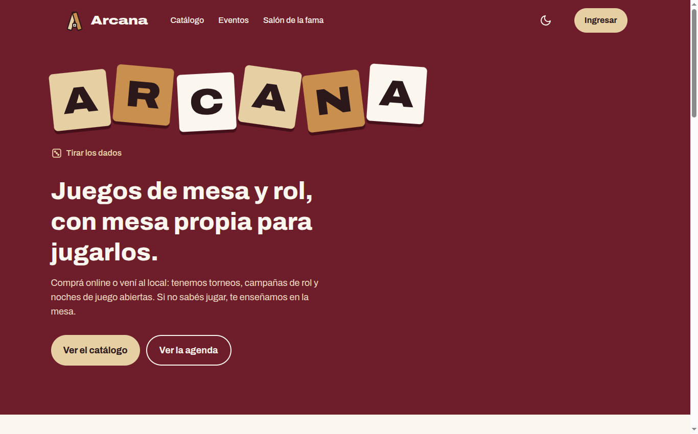

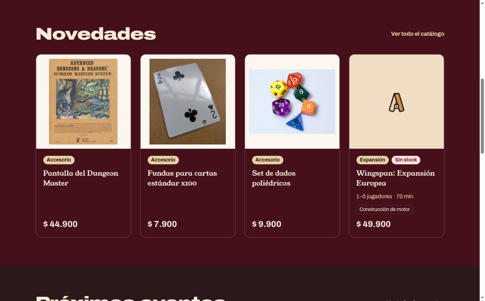

### Catálogo

Los filtros viven en la URL (`/catalogo?tipo=JUEGO_MESA&ordering=-precio`) y los aplica la API.

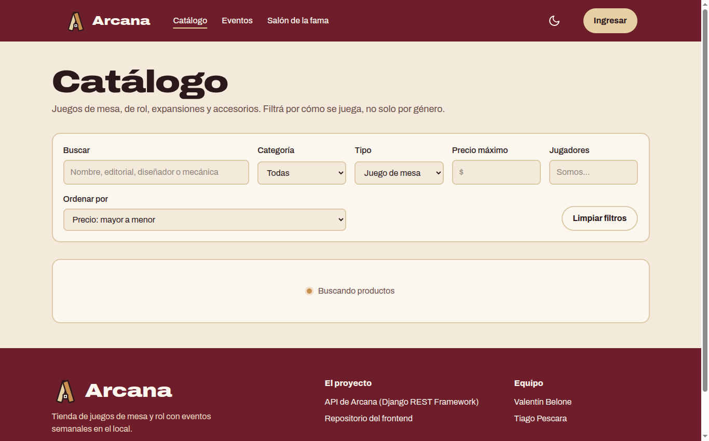

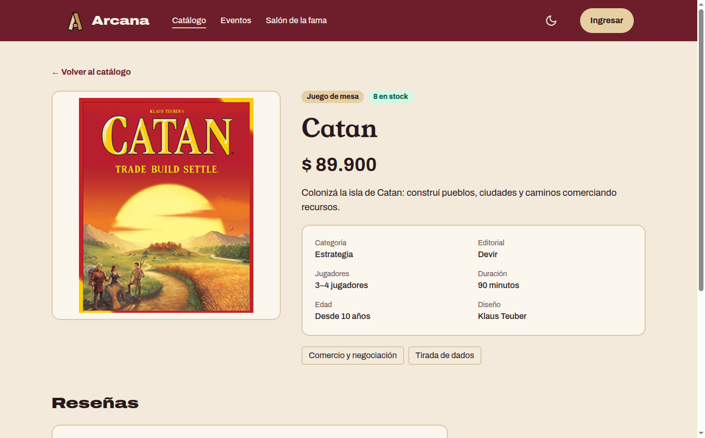

### Eventos y comunidad

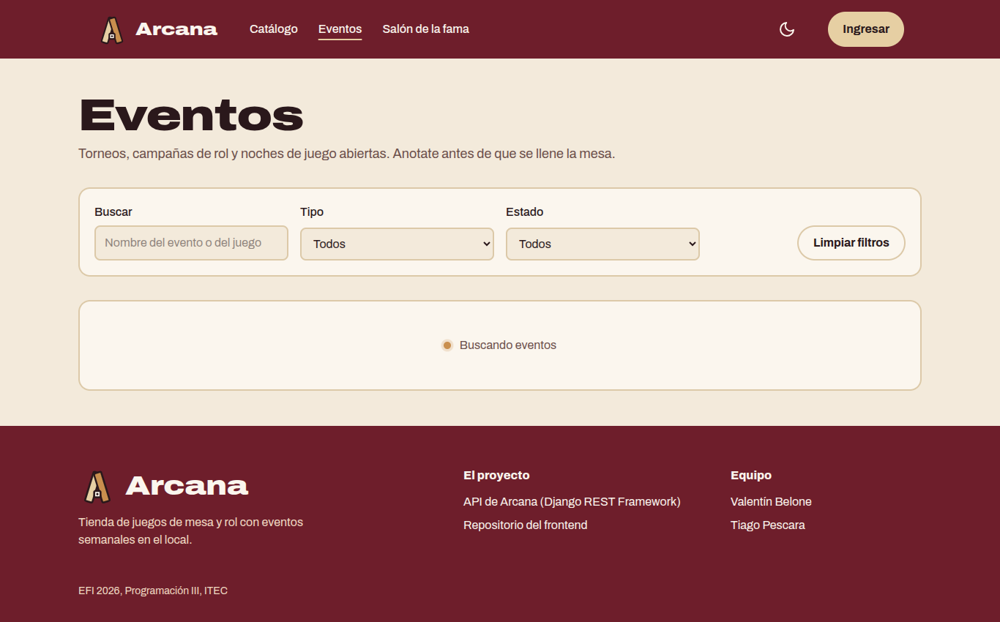

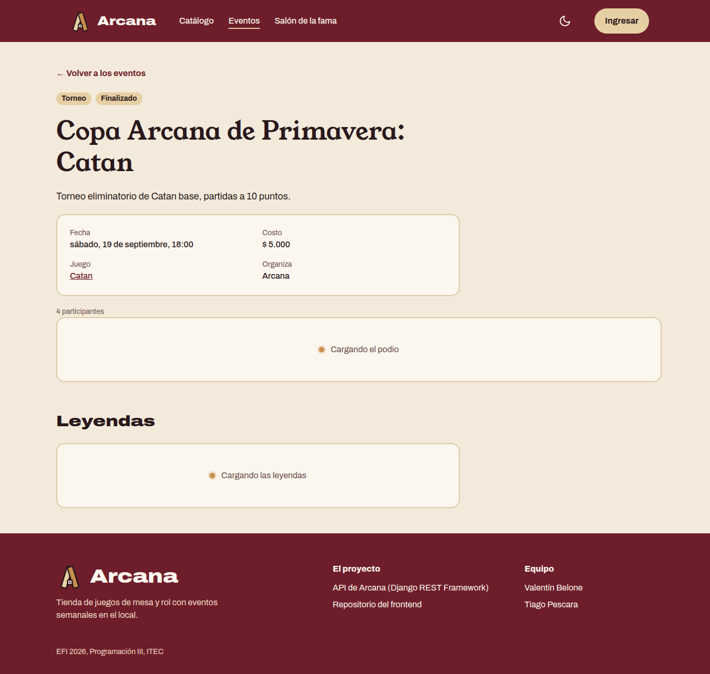

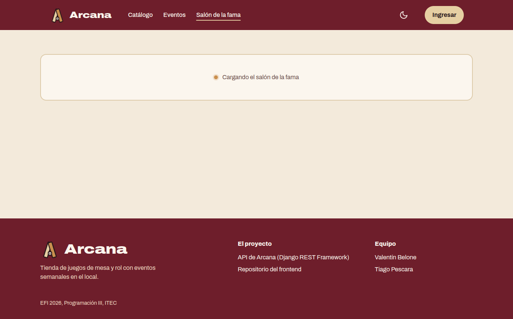

### Sesión y formularios

Los formularios muestran los errores de Zod en cada campo y los que devuelve la API.

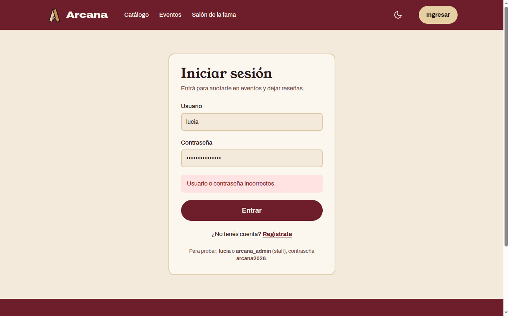

### Panel de staff

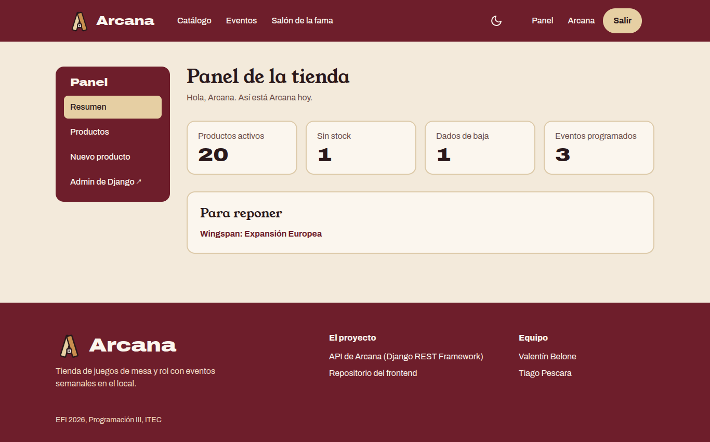

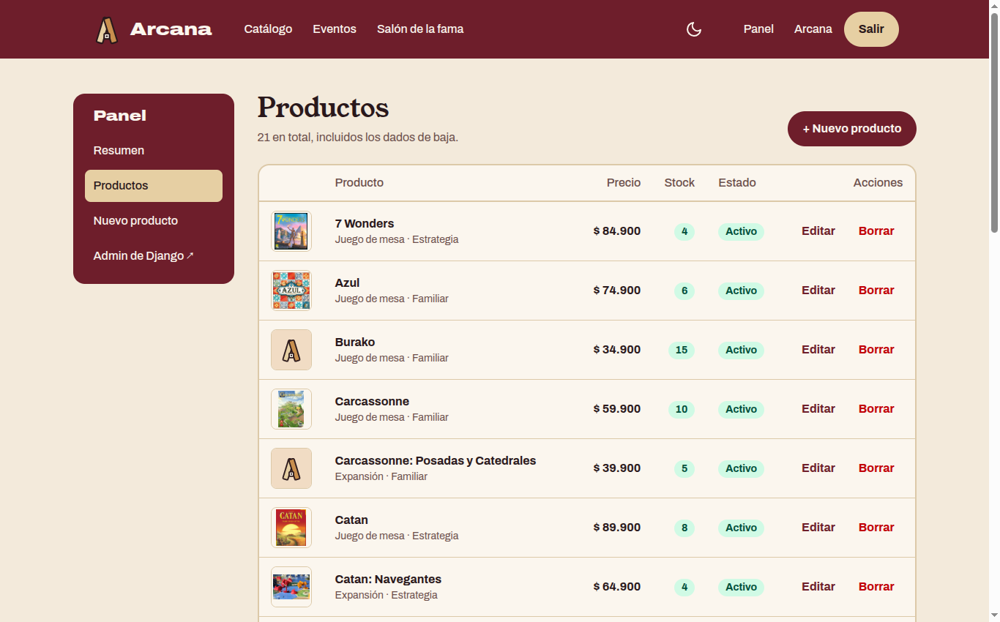

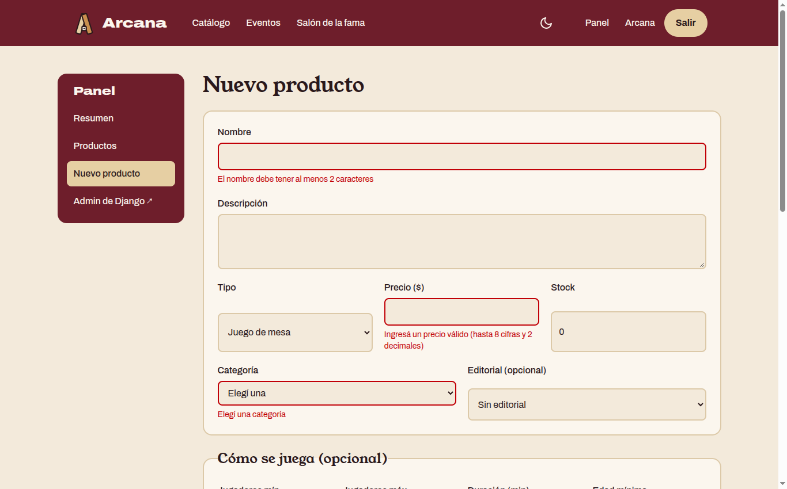

### Celular y tablero

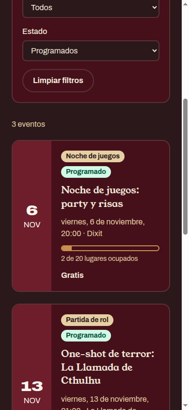

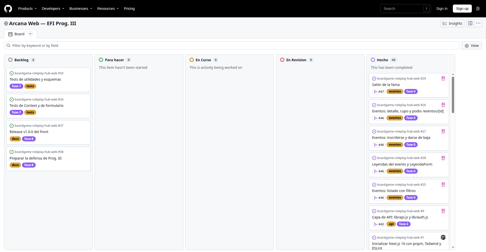

## Stack

- [Next.js 16](https://nextjs.org) (App Router) y React 19, en JavaScript.
- [Tailwind CSS 4](https://tailwindcss.com).
- [React Hook Form](https://react-hook-form.com) + [Zod](https://zod.dev) para los formularios.
- [Vitest](https://vitest.dev) + Testing Library para los tests.
- [pnpm](https://pnpm.io) como gestor de paquetes.

## Instalación

Requisitos: Node.js 20.9 o superior, pnpm (`corepack enable` lo deja disponible) y la [API de Arcana](https://github.com/ValenBelone7/boardgame-roleplay-hub-django) corriendo localmente con sus datos de ejemplo, o su URL desplegada.

```bash
git clone git@github.com:ValenBelone7/boardgame-roleplay-hub-web.git
cd boardgame-roleplay-hub-web
pnpm install
cp .env.example .env.local
pnpm dev
```

La aplicación queda en <http://localhost:3000>.

> Con npm también funciona: `npm install`, `npm run dev` y `npm run test`.

## Variables de entorno

| Variable | Descripción | Ejemplo |
|---|---|---|
| `API_URL` | URL base de la API de Arcana, sin barra final | `http://127.0.0.1:8000` |

Se definen en `.env.local`, que no se sube al repositorio. No lleva el prefijo `NEXT_PUBLIC_` porque la lee solo el servidor de Next: el navegador nunca habla directo con la API.

En producción (Vercel) vale `https://arcana-api-efi.onrender.com`.

## Scripts

| Comando | Qué hace |
|---|---|
| `pnpm dev` | Servidor de desarrollo |
| `pnpm build` | Build de producción |
| `pnpm start` | Sirve el build de producción |
| `pnpm lint` | ESLint |
| `pnpm test` | Tests con Vitest (`pnpm test --run` los corre una vez y termina) |

## Usuarios de demo

Vienen en los datos de ejemplo de la API. Todos tienen la contraseña **`arcana2026`**.

| Usuario | Alias | Rol |
|---|---|---|
| `arcana_admin` | Arcana | Staff: entra al panel y administra los productos |
| `lucia` | Lu la Estratega | Jugadora, primera en el salón de la fama |
| `mateo` | Mateo Dados | Jugador |
| `sofia` | Sofi Runas | Jugadora |
| `nicolas` | Nico el Bardo | Jugador |

## Rutas

| Ruta | Acceso | Qué muestra |
|---|---|---|
| `/` | Público | Inicio con novedades del catálogo y próximos eventos |
| `/catalogo` | Público | Catálogo con búsqueda, filtros, orden y paginación |
| `/catalogo/[id]` | Público | Detalle del producto y sus reseñas (escribir una pide sesión) |
| `/eventos` | Público | Eventos con búsqueda y filtros por tipo y estado |
| `/eventos/[id]` | Público | Detalle con cupo, inscripción, podio y leyendas |
| `/salon-de-la-fama` | Público | Ranking de jugadores y leyendas destacadas |
| `/login`, `/registro` | Público | Inicio de sesión y alta de usuario |
| `/cuenta` | Con sesión | Datos del usuario y sus inscripciones |
| `/panel` | Staff | Resumen de la tienda |
| `/panel/productos` | Staff | Listado de productos con borrado y baja lógica |
| `/panel/productos/nuevo` | Staff | Alta de producto |
| `/panel/productos/[id]/editar` | Staff | Edición de producto |

Además: `not-found` propio (general, de producto y de evento) y `loading.js` / `error.js` en el catálogo, los eventos, el salón de la fama y el panel.

## Arquitectura

```
src/
├── app/                # rutas (App Router)
│   ├── panel/          # sección de staff, con su propio layout (sidebar)
│   ├── context/        # TemaContext y SesionContext
│   ├── validations/    # esquemas de Zod
│   ├── __tests__/      # tests de Vitest
│   └── actions.js …    # Server Actions de cada sección
├── components/         # componentes reutilizables (tarjetas, formularios, filtros…)
└── lib/                # api.js, auth.js, filtros.js, formato.js, errores.js
```

- **Server y Client Components**: las páginas son Server Components y piden los datos directo a la API. Solo son Client los componentes con estado, eventos o Context: formularios, filtros, el botón de inscripción, el cambio de tema y la Navbar.
- **Sesión**: el login es una Server Action que pide el JWT a la API y lo guarda en una cookie `httpOnly`, que el JavaScript del navegador no puede leer. El servidor de Next la lee y manda el token como `Bearer` en cada operación protegida.
- **Rutas protegidas**: `/cuenta` y `/panel` verifican la sesión en el servidor antes de renderizar. Sin sesión redirigen a `/login`, y el panel además exige ser staff. La API igual valida cada permiso.
- **Estado global**: `TemaContext` (claro u oscuro) y `SesionContext` (usuario logueado), con `createContext` y `useContext`.
- **Filtros en la URL**: los listados leen `searchParams` y le pasan los filtros a la API. Así se pueden compartir y el botón Atrás funciona.
- **Formularios**: React Hook Form con el resolver de Zod. Zod corta antes del request y los errores que devuelve la API se muestran en su campo.
- **Carga y errores**: `loading.js` y `Suspense` muestran el estado de carga, y `error.js` muestra el error con un botón para reintentar.

## Tests

```bash
pnpm test --run
```

48 tests en 9 archivos de `src/app/__tests__/`. Vitest no soporta Server Components `async`, así que se testean esquemas, utilidades y contextos.

| Archivo | Qué cubre |
|---|---|
| `LoginSchema.test.js` | Campos vacíos o solo con espacios |
| `RegistroSchema.test.js` | Email inválido, contraseñas distintas, contraseña corta, usuario con espacios, fecha futura |
| `ProductoSchema.test.js` | Precio negativo, jugadores mínimos mayores que los máximos, expansión sin juego base |
| `InscripcionSchema.test.js` | Personaje opcional y largo máximo |
| `LeyendaSchema.test.js` | Largos mínimos del título y del relato |
| `formato.test.js` | Precios en pesos, fechas en hora de Argentina, cantidad de jugadores |
| `filtros.test.js` | Armado de la query y vuelta a la página 1 al cambiar un filtro |
| `errores.test.js` | Las formas en que DRF devuelve sus errores |
| `TemaContext.test.jsx` | Tema inicial y cambio de tema guardado |

## Despliegue

- **Front**: Vercel despliega la rama `main` en <https://arcana-web-efi.vercel.app>, con la variable `API_URL` de producción. Cada pull request genera su propio preview.
- **API**: Render, desde la rama `deploy` del repositorio de la API. [UptimeRobot](https://uptimerobot.com) la consulta cada 5 minutos para que el plan gratuito no la duerma.

## Flujo de trabajo con Git

- **Ramas:** `main` guarda solo las versiones entregables y `develop` integra el trabajo. Cada tarea se hace en una rama corta (`feature/`, `test/`, `docs/`, `chore/`) que sale de `develop` y vuelve por pull request.
- **Pull requests:** se mergean con *merge commit* para conservar los commits de cada rama. Cada PR cierra sus tarjetas del Kanban con `Closes #N`.
- **Commits:** [Conventional Commits](https://www.conventionalcommits.org/es/), en castellano e imperativo. Por ejemplo:
  - `feat(catalogo): agrega listado con busqueda, filtros y paginacion`
  - `feat(eventos): agrega inscripcion y baja de eventos`
  - `test(panel): cubre el esquema de producto`
- **Versiones:** `v1.0.0` es la entrega final, mergeada de `develop` a `main`.

| PR | Rama | Qué entregó |
|---|---|---|
| [#39](https://github.com/ValenBelone7/boardgame-roleplay-hub-web/pull/39) | `chore/bootstrap-next` | Proyecto Next.js con Tailwind y ESLint |
| [#40](https://github.com/ValenBelone7/boardgame-roleplay-hub-web/pull/40) | `feature/layout-identidad` | Identidad visual, layout raíz, Navbar y Footer |
| [#41](https://github.com/ValenBelone7/boardgame-roleplay-hub-web/pull/41) | `feature/tema-y-vitest` | Tema claro y oscuro con Context, y Vitest |
| [#42](https://github.com/ValenBelone7/boardgame-roleplay-hub-web/pull/42) | `feature/capa-api` | Capa para hablar con la API |
| [#43](https://github.com/ValenBelone7/boardgame-roleplay-hub-web/pull/43) | `feature/auth` | Login, registro, sesión y rutas protegidas |
| [#44](https://github.com/ValenBelone7/boardgame-roleplay-hub-web/pull/44) | `feature/catalogo` | Catálogo con filtros, detalle y reseñas |
| [#45](https://github.com/ValenBelone7/boardgame-roleplay-hub-web/pull/45) | `feature/panel-productos` | Panel de staff con CRUD de productos |
| [#46](https://github.com/ValenBelone7/boardgame-roleplay-hub-web/pull/46) | `feature/eventos` | Eventos, inscripción y leyendas |
| [#47](https://github.com/ValenBelone7/boardgame-roleplay-hub-web/pull/47) | `feature/salon-de-la-fama` | Salón de la fama |

## Equipo

- Valentín Belone
- Tiago Pescara
